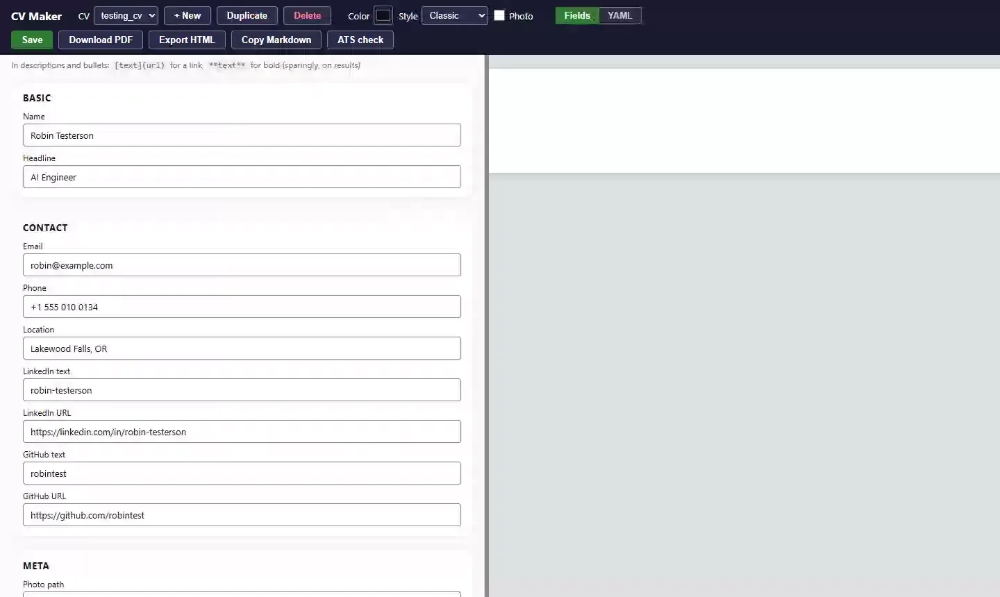
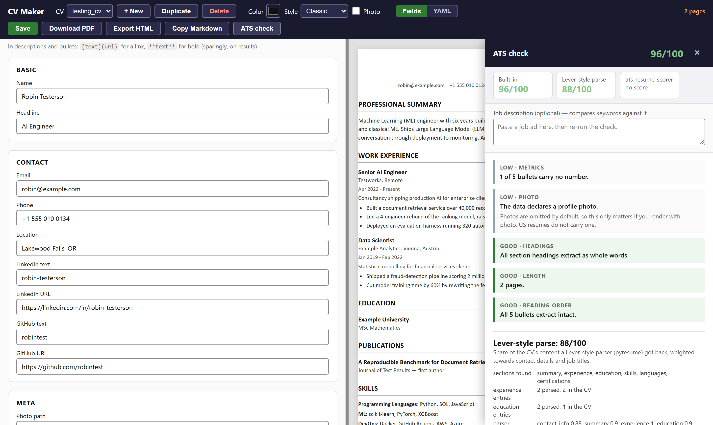

# CV Making Tool

Keep every version of your CV as plain YAML, edit it with a live preview, and see how it reads to an applicant tracking system before you send it.



## Features

- **Live editor.** A form view and a YAML view side by side with the rendered page.
- **One file per CV.** Keep a version per role or language. Duplicate one to tailor it.
- **Exports.** PDF, HTML, and Markdown for pasting into a chat.
- **Four styles.** Classic, Calibri airy, Cambria and Segoe UI, set per CV.
- **ATS check.** Renders the real PDF and reads it back the way a parser does, then reports what did not survive. Three independent scores, never blended.
- **Local and safe.** Your data never leaves `data/`, which git ignores. Every save keeps a backup, and a stale tab cannot silently overwrite newer work.

## Install

You need [uv](https://docs.astral.sh/uv/). PDF rendering uses [WeasyPrint](https://doc.courtbouillon.org/weasyprint/stable/first_steps.html), which needs Pango on the system:

| System | Command |
|---|---|
| Debian, Ubuntu | `sudo apt install libpango-1.0-0 libpangoft2-1.0-0 libharfbuzz-subset0` |
| Fedora | `sudo dnf install pango` |
| macOS | `brew install pango` |
| Windows | Install the GTK3 runtime, as in the WeasyPrint guide linked above |

## Usage

```bash
uv run python -m cv_maker --serve                 # editor at http://127.0.0.1:8765
uv run python -m cv_maker --cv acme               # PDF to output/acme.pdf
uv run python -m cv_maker --cv acme --ats-check   # ATS report; add --job-description jd.txt
uv run python -m cv_maker --list-cvs
```

On a fresh clone the first `--serve` creates a starter CV in `data/cv_data.yaml`.

Each CV sets its language and style under `meta`:

```yaml
meta:
  lang: en        # en or es; picks the section headers
  style: cambria  # classic, calibri-airy, cambria or segoe
```

In descriptions and bullets, `[text](url)` makes a link and `**text**` makes bold. Only `http`, `https` and `mailto` links become clickable. The photo is off by default, as US resumes expect; turn it on with **Photo** or `--photo`.

## ATS check



| Score | What it measures |
|---|---|
| **Built-in** | Headings and bullets survive extraction, contact details are in the text layer, dates parse, bullets carry numbers, and job-description keywords are present. |
| **Lever-style parse** | How much of your CV [pyresume](https://github.com/wespiper/pyresume), a Lever-like parser, recovers, and what it lost. |
| **ats-resume-scorer** | A rules-based score from the [package](https://pypi.org/project/ats-resume-scorer/) of that name, against a job description. Off by default because its first run installs about 400 MB. |

`CV_MAKER_EXTERNAL_ATS` picks what runs: `lever` (default), `all` or `off`. The command exits non-zero on critical or high findings, so it works as a pre-send check.

## Development

```bash
uv run pytest              # fast suite
uv run pytest -m browser   # drive the real editor with Playwright
uvx ruff check src tests
```

Browser tests use any installed Chromium-based browser; set `CV_MAKER_BROWSER` to choose one. Tests never touch `data/`: they use a fictional CV in `tests/fixtures/`. CI runs lint and the fast suite on every push.

## License

MIT. See [LICENSE](LICENSE).
